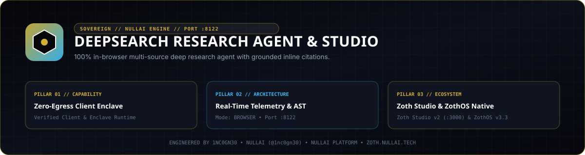
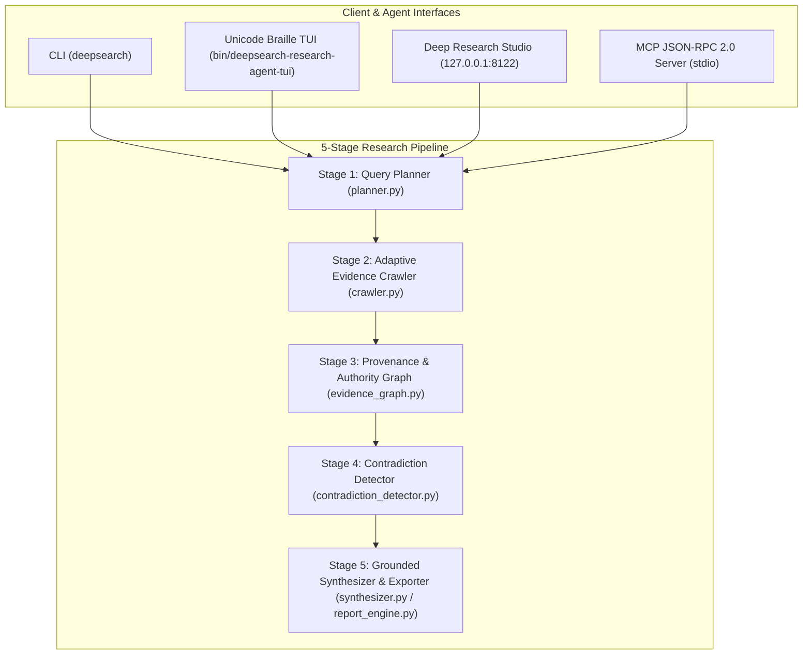

<div align="center">
  
</div>

# DeepSearch Research Agent & Studio

[](https://github.com/1nc0gn30/deepsearch-research-agent/actions/workflows/ci.yml)
[](https://www.python.org/downloads/)
[](LICENSE)
[](pyproject.toml)
[](https://zoth.nullai.tech/tools/deepsearch-research-agent)

Zero-dependency multi-source deep research agent, grounded citation graph analyzer, contradiction detector, and synthesis engine built on the Python 3.9+ standard library. Ships with a standalone offline-ready Deep Research Studio web interface on loopback port `127.0.0.1:8122`, a full CLI (`deepsearch`), and a JSON-RPC 2.0 Model Context Protocol (MCP) server.

Engineered by **1nc0gn30** ([@1nc0gn30](https://github.com/1nc0gn30), [1nc0gn30.si](https://1nc0gn30.si)) • **NullAI** ([nullai.tech](https://nullai.tech)).

---

## Overview

- **Zero Runtime Dependencies**: Pure Python 3.9+ standard library core (`urllib`, `html.parser`, `http.server`, `json`, `dataclasses`, `concurrent.futures`) paired with a self-contained browser UI.
- **Recursive Query Decomposition**: Tree-of-Thought query planner (`planner.py`) decomposes research questions into targeted sub-queries with configurable depth (`quick`, `standard`, `deep`, `exhaustive`).
- **Evidence Provenance & Citation Graph**: Tracks claim lineage, domain authority scores, credibility tiers, and circular citation loops (`evidence_graph.py`).
- **Dialectical Contradiction Detection**: Cross-validates quantitative and qualitative assertions across sources (`contradiction_detector.py`) to classify claims as `Verified`, `Contested`, or `Refuted`.
- **Multi-Format Report Export**: Synthesizes inline-cited Markdown, standalone HTML5, and machine-readable JSON bundles (`synthesizer.py`, `report_engine.py`).
- **100% Free & Open Source**: Every workspace tab, citation export, CLI subcommand, and MCP tool is unlocked with zero telemetry. Optional community support is available via [Buy Us a Coffee (Stripe)](https://buy.stripe.com/3cIfZg27PdKo2D64Ocfw40X).

---

## Architecture



Detailed architectural documentation is available in [`docs/RESEARCH_METHODOLOGY.md`](docs/RESEARCH_METHODOLOGY.md), [`docs/QUERY_PLANNING_GUIDE.md`](docs/QUERY_PLANNING_GUIDE.md), [`docs/MCP_GUIDE.md`](docs/MCP_GUIDE.md), and [`examples/`](examples/).

---

## Quickstart

### Clone and Install

```bash
git clone https://github.com/1nc0gn30/deepsearch-research-agent.git
cd deepsearch-research-agent
python3 -m pip install -e ".[dev]"
```

### Launch Local Workstation (`127.0.0.1:8122`)

```bash
# Lightweight static + telemetry workbench on 127.0.0.1:8122
python3 server.py --host 127.0.0.1 --port 8122

# Full REST API + Deep Research Studio server on 127.0.0.1:8122
python3 -m deepsearch_research_agent.cli serve --host 127.0.0.1 --port 8122
```

Open `http://127.0.0.1:8122` in your browser, or view the Zoth Studio v2 dossier at [`https://zoth.nullai.tech/tools/deepsearch-research-agent`](https://zoth.nullai.tech/tools/deepsearch-research-agent).

---

## CLI & MCP Usage

### CLI Subcommands (`deepsearch`)

```bash
# Inspect CLI options
deepsearch --help

# Generate a multi-stage Tree-of-Thought query plan
deepsearch plan "Fault-tolerant logical qubit scaling 2026" --depth deep --json

# Execute multi-perspective research and export Markdown / HTML / JSON
deepsearch research "Enterprise MCP agent security patterns" --depth standard --output report.md

# Fetch and extract clean text/Markdown from a URL
deepsearch fetch https://example.com

# Cross-validate claims and inspect citation provenance graphs
deepsearch corroborate --help
deepsearch provenance --help

# Run multi-OS platform diagnostics
deepsearch platform --json

# Serve Deep Research Studio + REST API on loopback port 8122
deepsearch serve --host 127.0.0.1 --port 8122
```

### ZothOS v3.4.0 CLI & Braille TUI Integration

```bash
# Unified Node/Electron launcher (delegates CLI flags or starts web mode on :8122)
node bin/deepsearch.js --help
node bin/deepsearch.js web

# Unicode U+2800 Braille TUI & JSON telemetry
python3 bin/deepsearch-research-agent-tui --json
python3 bin/deepsearch-research-agent-tui --benchmark
```

### Model Context Protocol (MCP) Server

Start the stdio JSON-RPC 2.0 server (sample client configurations in [`examples/mcp-clients/`](examples/mcp-clients/)):

```bash
deepsearch mcp
# or directly:
python3 -m deepsearch_research_agent.mcp_server
```

Registered MCP tools:
- `deepsearch` / `deepsearch_execute` — Execute end-to-end grounded multi-source research with inline citations.
- `deepsearch_plan` — Decompose a research prompt into structured sub-queries and focus perspectives.
- `deepsearch_fetch` — Retrieve and sanitize remote HTML/text documents with authority scoring.
- `deepsearch_corroborate` — Evaluate consensus vs contradiction across extracted source claims.
- `deepsearch_evidence_graph` — Construct provenance DAGs and detect circular citation loops.
- `deepsearch_export_report` — Render synthesized research into Markdown, HTML, or JSON bundles.
- `deepsearch_get_diagnostics` — Return runtime, platform, and engine health diagnostics.

---

## REST API Endpoints

When running `deepsearch serve --host 127.0.0.1 --port 8122` (or `python3 -m deepsearch_research_agent.ui_server --port 8122`):

| Method | Endpoint | Description |
| :--- | :--- | :--- |
| `GET` | `/api/health` | Service health status (`server.py` also exposes `/health` and `/api/stats`) |
| `GET` | `/api/diagnostics` | Multi-OS runtime and engine diagnostics |
| `GET` | `/api/mcp/config` | Ready-to-copy MCP JSON configs for Claude Desktop, Cursor, Cline, and Zed |
| `POST` | `/api/plan` | Generate a structured research query plan |
| `POST` | `/api/research` | Execute multi-source research and consensus synthesis |
| `POST` | `/api/fetch` | Fetch and extract clean content from a target URL |
| `POST` | `/api/corroborate` | Run dialectical claim corroboration and contradiction checks |
| `POST` | `/api/export` | Export synthesized dossier as Markdown or HTML |
| `POST` | `/api/export-bundle` | Export full machine-readable JSON research bundle |

Mutating `POST` endpoints enforce local-origin CSRF verification (`127.0.0.1`, `localhost`, `::1`).

---

## Testing & Verification

```bash
# Run full unit, example, origin-guard, and UI regression test suite
python3 -m pytest -q

# Verify CLI & TUI entrypoints
PYTHONPATH=src python3 -m deepsearch_research_agent.cli --help
PYTHONPATH=src python3 -m deepsearch_research_agent.cli platform --json
python3 bin/deepsearch-research-agent-tui --json

# Secret & PII scan
gitleaks detect --source . --no-banner --redact
```

---

## License

MIT License. Copyright (c) 2026 1nc0gn30 & NullAI. See [`LICENSE`](LICENSE) for details.
